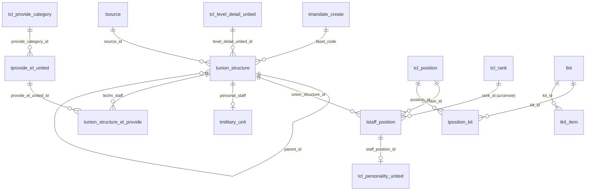
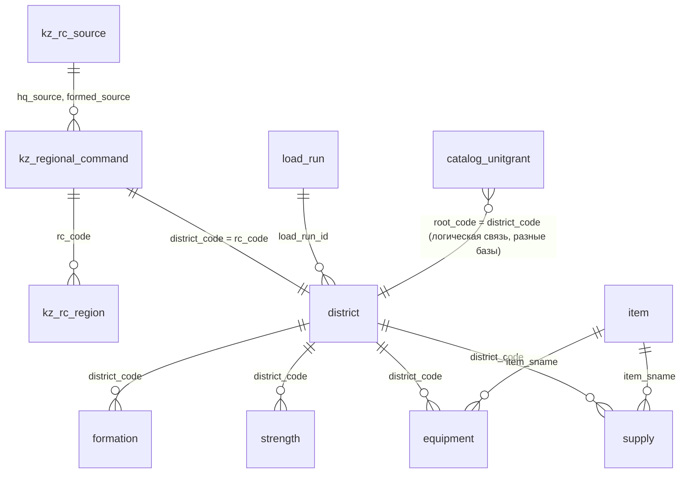

# Фактическая основа данных платформы: уровень округа

Дата сбора: 2026-11-12. Уровень детализации: округ (региональное командование ВС РК).
Задание: найти и систематизировать подтверждённые данные для проектирования. Архитектура, код и технологии здесь не обсуждаются.

## Как читать

- **Подтверждено** — факт взят из файла проекта, базы данных или опубликованного документа. Источник указан точно.
- **Не найдено** — в доступных материалах сведений нет. Указано, у кого их запросить.
- **Проектное** — предложение команды, а не существующая структура.
- Все базы проекта учебные. По `README.md` проекта они «НЕ является актуальной базой ВС РК»; ФИО, ИИН и нормы в них вымышлены или условны.
- Реальные численность, оргструктура и дислокация войск по Закону РК № 349-I «О государственных секретах» относятся к государственным секретам (см. п. 1.5). Поэтому в открытых источниках их нет, и в этом отчёте они не подбирались.

Короткие обозначения файлов:

| Обозначение | Файл |
|---|---|
| `SQLITE` | `military_db_v2.db` (архив `Archive 2.zip`, папка `~/Desktop/Military Dept/2 участник/`), SHA-256 `dcd3b570…ee1`, совпадает с `SOURCE_MANIFEST.json` |
| `PG` | PostgreSQL 16.15, база `military_lab` (контейнер `military-demo-full-db-1`), состояние на 2026-11-12 |
| `AUTH` | PostgreSQL, база `registry_auth` (пользователи и права Django) |
| `WB` | `Штатные_должности_численность_имущество_2026.xlsx`, SHA-256 `282a7022…e57`, совпадает с манифестом; загружен в `refdata.workbook_row`; дата проверки в файле — 29.10.2026 |
| `УСТАВ` | Устав внутренней службы ВС, других войск и воинских формирований РК, утв. Указом Президента РК от 05.07.2007 № 364, ред. Указа от 02.02.2016 № 187, изменения на 01.07.2026 ([текст](https://zakon.uchet.kz/rus/docs/U070000364_)); прочитаны символы 0–400 000 из 869 364 |

---

## 1. Таблица подтверждённых данных

### 1.1. Источники данных

| № | Факт | Источник | Дата актуальности | Статус |
|---|---|---|---|---|
| 1 | Исходные данные модели — документ «Программа и методика испытаний «База данных» (контрольный пример)», издатель «Заказчик», лицензия «служебный документ пользователя» | `SQLITE`, `tsource`, `source_id = 1`, `source_code = 'PMI'` | запись от 2026-10-08 | Подтверждено. **Сам документ ПМИ в материалах не найден** |
| 2 | Версия ОШС (мандат): `faset_code = '2.3182639.2012-10-08 00:00:00_666+03.г.д.е.1.0.з.и.0'`, `create_date = '2012-10-08'`, `note = 'Контрольный пример ПМИ'` | `SQLITE`, `tmandate_create` (1 строка) | 2012-10-08 | Подтверждено |
| 3 | Классификатор уровней формирований: «ПМИ, табл. 1» | `SQLITE`, `tmeta_table`, строка `tcl_level_detail_united` | 2026-10-08 | Подтверждено |
| 4 | Цепочка сборки: SQLite → Excel-выгрузки (`brigade_все_данные.xlsx`, `military_db_v2_обзор.xlsx`) → `import_mil.py` → `mil_core`; затем `enrich.py` и `kz_localize.py` | `docs/STAGE1_REPORT.md`, раздел «Цепочка сборки» | 2026-11-12 | Подтверждено |
| 5 | Сверка с Excel: 9 проверок, во всех `rows_diff = 0` | `PG`, `etl.reconcile` | загрузка `run_id = 1` | Подтверждено |
| 6 | Открытый поиск по РК уже выполнен по Әділет и gov.kz: проверены Закон № 561-IV, Указ № 364, Приказ МО № 277 | `WB`, лист «Пояснения», строка 24 | 29.10.2026 | Подтверждено |
| 7 | «Полный штат 2026 конкретных частей не установлен»: опубликованный утверждённый штат с номером, датой и табелем не найден | `WB`, «Пояснения», строка 9; «Нормативная численность», строка 5 (12 мбр: «Утверждённый штат 2026 не найден») | 29.10.2026 | Подтверждено (как результат поиска) |
| 8 | Отдельный модуль инструментов агента (4-й участник): `search_units`, `search_items`, `get_unit_stock`, `get_item_distribution`, `get_shortages`; данные фиктивные (`InMemoryRepository`) | `~/Desktop/Military Dept/4 участник/README.md` | 2026-10-15 | Подтверждено |
| 9 | Действующая база учёта подразделений ВС РК (название системы, схема, владелец) | — | — | **Не найдено.** Запросить у заказчика: какая система ведёт учёт и на основании какого документа |

### 1.2. Организационная структура (уровень округа)

| № | Факт | Источник | Дата актуальности | Статус |
|---|---|---|---|---|
| 1 | В ВС РК четыре региональных командования: «Астана», «Восток», «Запад», «Юг» | Указ Президента РК от 07.05.2003 № 1085, п. 2 ([текст](https://zakon.uchet.kz/rus/docs/U030001085_)) | 2003-05-07; утратил силу 12.07.2012 | Подтверждено (A) |
| 2 | Зоны ответственности РгК по областям: «Астана» — г. Астана, Акмолинская, Карагандинская, Костанайская, Северо-Казахстанская; «Восток» — Восточно-Казахстанская, Павлодарская; «Запад» — Актюбинская, Атырауская, Западно-Казахстанская, Мангистауская; «Юг» — г. Алматы, Алматинская, Жамбылская, Кызылординская, Южно-Казахстанская | Указ от 12.07.2012 № 354, п. 2 ([текст](https://zakon.uchet.kz/rus/docs/U1200000354)) | 2012–2018 | Подтверждено (A), **не действует**: утратил силу Указом от 27.04.2018 № 676-ДСП |
| 3 | Действующее распределение областей по РгК (с учётом областей Абай, Жетісу, Улытау, образованных в 2022 г., Туркестанской области и г. Шымкента, появившихся в 2018 г.) | — | — | **Не найдено:** акт № 676-ДСП не опубликован. В `refdata.kz_rc_region` распределено по выводу (B). Запросить у заказчика |
| 4 | Штабы: «Астана» — Караганда, «Восток» — Семипалатинск (Семей), «Запад» — Атырау, «Юг» — Тараз | [Kapital.kz, 11.05.2014](https://kapital.kz/gosudarstvo/29796/u-kazahstana-samaya-mocshnaya-armiya-v-centralnoj-azii.html); Тараз и Атырау также [Kazinform](https://www.inform.kz/ru/kak-gotovyat-voennuyu-tehniku-k-zime-v-regional-nom-komandovanii-yug_a3847047) | 2014 | Подтверждено СМИ (B), в нормативных актах не названы |
| 5 | Военные округа созданы указом от 06.07.2000, в мае 2003 г. преобразованы в РгК | [Википедия](https://ru.wikipedia.org/wiki/Вооружённые_силы_Республики_Казахстан) | — | B (энциклопедия) |
| 6 | РгК «Юг» — «одно из крупнейших территориальных объединений в составе Сухопутных войск» | Kazinform (выдача поиска по РгК «Юг») | 2026 | B |
| 7 | В классификаторе ПМИ есть уровни `21 'Военный округ'`, `33 'Военный округ'` (дубль) и `56 'Региональное командование'`, а также `36 'Командование'`, `38 'Вооруженные силы'` | `SQLITE`, `tcl_level_detail_united` (48 строк) | 2026-10-08 | Подтверждено. Дубль 21/33 отброшен при импорте (`PG`, `etl.reject`) |
| 8 | Уровни ниже бригады, описанные Уставом: бригада, батальон, рота, взвод, отделение | `УСТАВ`, обязанности командиров: п. 55 (бригада), пп. 101–102 (батальон), 117–118 (рота), 125–126 (взвод), 142 (отделение) | 01.07.2026 | Подтверждено |
| 9 | Принцип подчинённости в модели: дерево по иерархическому коду; все подчинённые — `structure_code LIKE '<код>%'`; глубина `level_num` = число сегментов кода («аналог f_code_to_level») | `SQLITE`, `tmeta_column` для `tunion_structure` | 2026-10-08 | Подтверждено (модель ПМИ) |
| 10 | Место 12 мбр в модели: `20.` ВС РК → `20.0.` СВ ВС РК → `20.0.6.` РгК «Восток» → `20.0.6.0.` «ОА (усл.)» → `20.0.6.0.0.` «АК (усл.)» → `20.0.6.0.0.2.` 12 мбр | `PG`, `mil_core.unit` | 2026-11-12 | Подтверждено. Узлы ОА и АК помечены в базе: «условное звено из ПМИ, в ВС РК нет» |
| 11 | Состав соединений каждого РгК (номера бригад, их типы, подчинённость) | — | — | **Не найдено** в открытых нормативных источниках; относится к гос. секретам (п. 1.5). В `district.formation` — условные соединения (C) |
| 12 | Статья Закона «Об обороне и Вооруженных Силах» (№ 29-III от 07.01.2005) о составе ВС и органах военного управления | — | — | **Не найдено:** текст закона на adilet.zan.kz не загрузился. Проверить вручную |

### 1.3. Учёт личного состава

| № | Факт | Источник | Дата актуальности | Статус |
|---|---|---|---|---|
| 1 | Четыре показателя численности: командир роты обязан знать численность «по штату, списку, налицо и в расходе» | `УСТАВ`, п. 118, пп. 11 | 01.07.2026 | Подтверждено |
| 2 | Командир части обязан «постоянно иметь точные сведения о списочном и наличном составе» | `УСТАВ`, п. 36, пп. 5 | 01.07.2026 | Подтверждено |
| 3 | Списочный и наличный состав указываются в акте приёма-сдачи должности командира части и командира подразделения | `УСТАВ`, пп. 51, 52 | 01.07.2026 | Подтверждено |
| 4 | Учёт сведений о наличии личного состава организует начальник штаба: бригады (сведения дают заместители командира и начальники родов войск и служб) и батальона | `УСТАВ`, п. 58, пп. 13, 16; п. 104, пп. 3, 12 | 01.07.2026 | Подтверждено |
| 5 | Сведения о расходе личного состава и об отсутствующих на вечерней поверке командир роты (сержант роты) представляет дежурному по воинской части через дежурного по роте | `УСТАВ`, п. 138, пп. 20; п. 134, пп. 6 | 01.07.2026 | Подтверждено |
| 6 | Командир взвода ведёт именной список личного состава взвода | `УСТАВ`, п. 126, пп. 5 | 01.07.2026 | Подтверждено |
| 7 | Определения «штатная», «списочная», «наличная» численность как термины | — | — | **Не найдено** в прочитанных частях Устава и в приказах МО на adilet.zan.kz. Запросить: Генеральный штаб ВС РК / кадровый орган МО (форма строевой записки и инструкция по учёту) |
| 8 | Форма и периодичность строевой записки, порядок свода данных снизу вверх до округа | — | — | **Не найдено** в прочитанной части Устава (до символа 400 000). Дочитать раздел о суточном наряде; запросить форму у заказчика |
| 9 | В модели «штат» и «список» хранятся раздельно: штатное место — `tstaff_position` (6993), военнослужащий на месте — `tcl_personality_united.staff_position_id` (3518) | `SQLITE`, `tmeta_table` | 2026-10-08 | Подтверждено (модель) |
| 10 | Показатель «налицо / в расходе» в моделях не хранится: нет таблицы статуса присутствия (отпуск, командировка, госпиталь, наряд) | `SQLITE`, `PG` (просмотр схем) | 2026-11-12 | Подтверждено отсутствие |
| 11 | В рабочей книге: «Штат — разрешённые места; доктрина — типовая организация; нормы снабжения — положенность категории; person_issue — выдача модели. Эти величины не взаимозаменяемы» | `WB`, «Пояснения», строка 20 | 29.10.2026 | Подтверждено (правило проекта) |
| 12 | Численность разных уровней не суммировать: «Значения на разных уровнях вложены друг в друга» | `WB`, лист «Нормативная численность», примечание | 29.10.2026 | Подтверждено (правило проекта) |

### 1.4. Должности, звания и имущество

| № | Факт | Источник | Дата актуальности | Статус |
|---|---|---|---|---|
| 1 | Названия воинских званий РК устанавливает ст. 19 Закона РК от 16.02.2012 № 561-IV; перечень должностей и соответствующих званий утверждает Президент (ст. 21) | `WB`, «Пояснения», строка 11; [Закон № 561-IV](https://old.adilet.zan.kz/rus/docs/Z1200000561) | 29.10.2026 | Подтверждено |
| 2 | Открытый перечень «должность — штатное звание» для конкретных частей | — | — | **Не найдено** (`WB`, «Пояснения», строка 11). Запросить у заказчика |
| 3 | Названия и обязанности должностей (командир батальона, роты, взвода; сержант-инструктор батальона, роты, взвода) | `УСТАВ`, пп. 101–102, 117–118, 125–126, 131–134, 139; `WB`, лист «Должности и звания», строки 5–10 | 01.07.2026 | Подтверждено. Число мест по штату Устав не устанавливает |
| 4 | Нормы вещевого снабжения (контракт — норма № 2, призыв — норма № 4), мирное время; например, полевой костюм — 2 компл. на 1 год | Приказ МО РК от 27.05.2015 № 277, ред. от 09.09.2025 № 1236 ([текст](https://old.adilet.zan.kz/rus/docs/V1500011557)); `WB`, «Имущество по нормам», строки 5–20 | 09.09.2025 | Подтверждено (выборка, не полный табель) |
| 5 | Табель вооружения, техники и группового имущества к штату 2026 | — | — | **Не найдено** (`WB`, «Имущество по нормам», строка 27). Запросить у заказчика |
| 6 | Категории имущества в модели: 12 категорий `tcl_provide_category` (бронетанковое вооружение и техника, РАВ, стрелковое оружие, боеприпасы, автомобильная техника, инженерная, связь и АСУ, ремонтные и тыловые средства, вещевое, СИБ, СИЗ и медицинское, приборы) | `SQLITE`, `tcl_provide_category` | 2026-10-08 | Подтверждено (модель ПМИ) |
| 7 | Атрибуты образца: `provide_el_united_sname` (сокращённое), `provide_el_united_name` (полное), `provide_category_id`, `unit_measure`, `country` (страна-разработчик) | `SQLITE`, `tprovide_el_united`, `tmeta_column` | 2026-10-08 | Подтверждено |
| 8 | Штатное ВВТ формирования хранится как количество `techn_staff` по паре (формирование, образец), собственное, без подчинённых | `SQLITE`, `tunion_structure_el_provide` | 2026-10-08 | Подтверждено |
| 9 | Табель положенности: должность → комплекты (`tposition_kit`) → предметы и количество на одного военнослужащего (`tkit_item`) | `SQLITE`, `tmeta_table` | 2026-10-08 | Подтверждено. Нормы условные (`tsource.source_code = 'NORM'`: «требуют замены на действующие нормы») |
| 10 | В проекте Excel-импорта для наличия ВВТ предусмотрены три количества на дату среза: `qty_staff` (по штату), `qty_actual` (в наличии), `qty_serviceable` (исправно, ≤ в наличии) | `schema_proposal.sql`, `excel_core.vvt_holding` | 2026-10-15 | **Проектное**: в рабочую базу не загружалось |

### 1.5. Права доступа

| № | Факт | Источник | Дата актуальности | Статус |
|---|---|---|---|---|
| 1 | Сведения, раскрывающие дислокацию, действительные наименования, организационную структуру, вооружение, численность войск (кроме объявляемых открыто по международным обязательствам), относятся к государственным секретам в военной области | Закон РК от 15.03.1999 № 349-I «О государственных секретах», перечень сведений в военной области ([текст](https://pavlodar.com/zakon/?dok=00090&uro=080013)) | изменения на 2026 г. | Подтверждено по копии текста. **Номер статьи не подтверждён**, сверить на adilet.zan.kz |
| 2 | Персональные данные — сведения о субъекте с одним или несколькими идентификаторами | Закон РК от 21.05.2013 № 94-V, ст. 1 ([текст](https://zakon.uchet.kz/rus/docs/Z1300000094)) | ред. 2026 | Подтверждено |
| 3 | Требования стенда: `registry_reader` видит только `registry_api` и `refdata`; доступа к персональным и медицинским записям нет; `EXECUTE` на функции `fn_*` отозван у PUBLIC; ИИ не получает SQL и пароль `postgres`; порт PostgreSQL наружу не открывать | `README.md` проекта, разделы «Что собрано», «Важно про Django и ИИ» | 2026-11-05 | Подтверждено (требования проекта) |
| 4 | Роли сайта: `manager`, `viewer` (`catalog_userrole.role`, одна роль на пользователя); право — пара (пользователь, `root_code`), с 2026-11-12 `root_code` = код округа | `AUTH`, `catalog_userrole`, `catalog_unitgrant`; `docs/CONCEPT_DISTRICTS.md`, раздел 4 | 2026-11-12 | Подтверждено |
| 5 | `manager` выдаёт и отзывает права только у `viewer` и только на свои округа; каждое действие пишется в `catalog_grantaudit` | `web/catalog/services.py`; `AUTH`, `catalog_grantaudit` | 2026-11-12 | Подтверждено |
| 6 | Принципы 4-го участника: пользователь приходит от backend, не от LLM; права проверяются в каждой функции; итоги считаются только по доступной области; «нет такого подразделения» и «нет доступа» неразличимы | `4 участник/README.md`, «Принципы безопасности» | 2026-10-15 | Подтверждено. Правила по ролям там помечены «ПРЕДПОЛОЖЕНИЕ — согласовать с backend» |
| 7 | Реальная матрица доступа (какие должности какие округа видят, допуск к гос. секретам, режим ДСП) | — | — | **Не найдено.** Запросить у заказчика и режимно-секретного органа |

### 1.6. Обновление данных и история

| № | Факт | Источник | Дата актуальности | Статус |
|---|---|---|---|---|
| 1 | Проверка наличия материальных средств на складах и в подразделениях — не реже двух раз в год (заместитель командира бригады по тылу) | `УСТАВ`, п. 68, пп. 13 | 01.07.2026 | Подтверждено |
| 2 | Проверка наличия горючего, продовольствия, вещевого имущества — не реже одного раза в два месяца (начальники служб ГСМ, продовольственной, вещевой) | `УСТАВ`, п. 88, пп. 4; п. 89, пп. 7; п. 90, пп. 5 | 01.07.2026 | Подтверждено |
| 3 | Сверки учётных данных с подразделениями, складом и довольствующим органом — «в установленные сроки» | `УСТАВ`, п. 79, пп. 21 | 01.07.2026 | Подтверждено; сами сроки — **Не найдено** |
| 4 | Журнал загрузок: `etl.load_run` (запуск, статус, статистика, с этапа 2 — `stage`, `kind`, `script_name`); отбраковка `etl.reject` с файлом, листом и номером строки Excel; сырые строки `excel_stage.raw_row` (JSONB) | `PG`; `schema_proposal.sql` | 2026-11-12 | Подтверждено |
| 5 | Достоверность каждого значения: A — дословно из источника, B — выведено, C — справочное/оценка/условная норма | `SQLITE`, `tcl_confidence` | 2026-10-08 | Подтверждено |
| 6 | Версия структуры на дату: `tmandate_create` (мандат ОШС); в `mil_core` эта связь потеряна | `SQLITE`; `docs/STAGE1_REPORT.md` | 2026-11-12 | Подтверждено |
| 7 | Ни одна строка `mil_core` не ссылается на `etl.load_run.run_id`; изменения после загрузки (`enrich.py`, `kz_localize.py`) в журнал не попали | `docs/STAGE1_REPORT.md`, разделы «Источник и достоверность», «Найденные расхождения» | 2026-11-12 | Подтверждено |
| 8 | Реальные источники поступления данных об округах и периодичность их обновления | — | — | **Не найдено.** Запросить у заказчика |

### 1.7. Требования проекта

| № | Требование | Источник | Дата | Статус |
|---|---|---|---|---|
| 1 | Пользователь задаёт вопросы обычным языком и получает точные ответы в пределах своих прав | задание аналитику (текст от пользователя) | 2026-11-12 | Подтверждено |
| 2 | Записей слишком много: структуру свести к уровню округов; названия должны показывать, что база учебная | `docs/CONCEPT_DISTRICTS.md`, раздел 1 («Замечание заказчика») | 2026-11-12 | Подтверждено |
| 3 | Решение от 12.11.2026: округа — реальные РгК; состав и числа условные (C); данные США в сводную модель не входят | `docs/CONCEPT_DISTRICTS.md`, блок «Решение» | 2026-11-12 | Подтверждено |
| 4 | Помощник локальный, без внешнего ИИ; SQL не пишет; данные через фиксированные инструменты с проверкой прав; журнал вопросов | `web/templates/base.html` («Нет подключения к внешнему ИИ», надпись до 12.11.2026); `docs/CONCEPT_DISTRICTS.md`, раздел 5 | 2026-11-12 | Подтверждено (выбор модели — открытый вопрос, раздел 7 концепции) |
| 5 | Изменяющие функции (`fn_issue`, `fn_request_fulfil`, `fn_check_and_request`) ИИ не вызывает | `README.md`, «Важно про Django и ИИ» | 2026-11-05 | Подтверждено |
| 6 | Задачи руководителя, протоколы согласования, техническое задание | — | — | **Не найдено** в материалах. Запросить у руководителя проекта |

---

## 2. Реально найденная структура баз данных

Найдены три **существующие** базы. Все они созданы командой проекта на основе контрольного примера ПМИ. Реальной базы ВС РК среди них нет. Оригинальные названия сохранены.

### 2.1. `military_db_v2.db` (SQLite) — первичная модель ПМИ

32 таблицы и 19 представлений. Ниже основные таблицы; полный список проверяется командой `pragma table_info`.

| Таблица | Строк | Поля (тип; PK, NN — not null) | Внешние ключи |
|---|---|---|---|
| `tunion_structure` | 957 | `union_structure_id INTEGER PK`, `parent_id INTEGER`, `structure_code TEXT NN`, `faset_code TEXT NN`, `sname TEXT NN`, `full_name TEXT`, `level_detail_united_id INTEGER`, `level_num INTEGER NN`, `sort_order INTEGER`, `side TEXT NN`, `country TEXT`, `source_id INTEGER`, `confidence TEXT` | `parent_id → tunion_structure`; `level_detail_united_id → tcl_level_detail_united`; `faset_code → tmandate_create`; `source_id → tsource`; `confidence → tcl_confidence` |
| `tcl_level_detail_united` | 48 | `level_detail_united_id INTEGER PK`, `level_detail_united_name TEXT NN` | — |
| `tmandate_create` | 1 | `faset_code TEXT PK`, `create_date TEXT NN`, `note TEXT` | — |
| `tstaff_position` | 6993 | `staff_position_id INTEGER PK`, `union_structure_id INTEGER NN`, `position_id INTEGER NN`, `rank_id INTEGER NN`, `order_num INTEGER NN`, `source_id INTEGER`, `confidence TEXT` | `→ tunion_structure`, `→ tcl_position`, `→ tcl_rank`, `→ tsource`, `→ tcl_confidence` |
| `tcl_personality_united` | 3518 | `personality_id INTEGER PK`, `personality_family TEXT NN`, `personality_name TEXT NN`, `personality_patronymic TEXT NN`, `birth_date TEXT`, `rank_id INTEGER`, `staff_position_id INTEGER` | `→ tstaff_position`, `→ tcl_rank` |
| `tmilitary_unit` | 442 | `union_structure_id INTEGER PK`, `personal_staff INTEGER NN` («Число военнослужащих в самом формировании»), `source_id`, `confidence` | `→ tunion_structure` |
| `tforeign_unit` | 383 | то же для противника | `→ tunion_structure` |
| `tcl_position` | 267 | `position_id INTEGER PK`, `position_name TEXT NN`, `staff_category TEXT NN`, `army TEXT` | — |
| `tcl_rank` | 27 | `rank_id INTEGER PK`, `rank_name TEXT NN`, `staff_category TEXT NN`, `army TEXT` | — |
| `tprovide_el_united` | 307 | `provide_el_united_id INTEGER PK`, `provide_el_united_sname TEXT NN`, `provide_el_united_name TEXT NN`, `provide_category_id INTEGER`, `unit_measure TEXT NN`, `country TEXT` | `→ tcl_provide_category` |
| `tcl_provide_category` | 12 | `provide_category_id INTEGER PK`, `provide_category_name TEXT NN` | — |
| `tunion_structure_el_provide` | 880 | PK (`union_structure_id`, `provide_el_united_id`), `techn_staff INTEGER NN`, `source_id`, `confidence`, `note` | `→ tunion_structure`, `→ tprovide_el_united` |
| `tkit`, `tkit_item`, `tposition_kit` | 35 / 108 / 1308 | комплекты, состав комплекта (`qty`), табель «должность → комплект» | `→ tcl_position`, `→ tprovide_el_united` |
| `tsource`, `tcl_confidence`, `tsource_total` | 35 / 3 / 8 | реестр источников; шкала A/B/C; итоги источников для сверки | — |
| `tmeta_table`, `tmeta_column` | 49 / 37 | встроенный словарь данных | — |

Особенности, важные для проектирования:

- В `tcl_personality_united` нет статуса присутствия. Учёт «налицо / в расходе» по этой модели невозможен.
- Собственная численность (`tmilitary_unit.personal_staff`) хранится отдельно от числа штатных мест (`tstaff_position`). Сверка `etl.reconcile` подтверждает, что для своих войск они совпадают (442 из 442).
- Уровень «округ / региональное командование» в классификаторе есть (`21`, `33`, `56`). В дереве он один: узел РгК «Восток».

### 2.2. `military_lab` (PostgreSQL) — рабочая база стенда

| Схема | Назначение | Основные объекты (PK) |
|---|---|---|
| `mil_core` | импорт модели ПМИ + генерация | `unit (unit_code)`, `staff_position (staff_id)`, `person (person_id)`, `person_profile (person_id)`, `rank (rank_name)`, `position (position_name)`, `item (item_sname)`, `holding (unit_code, item_sname)`, `vehicle (vehicle_id)`, `warehouse (warehouse_id)`, `stock_movement (movement_id)`; всего 30 таблиц, 46 FK |
| `district` | сводная модель по округам (этап `70_districts.sql`); вымышленный личный состав — `person`, `person_post` (этап `72_district_people.sql`, запускать после 70: тот пересоздаёт схему) | `district (district_code)`, `formation (formation_code)`, `strength (district_code, category)`, `equipment (district_code, item_sname)`, `supply (district_code, item_sname)` |
| `refdata` | справочники | `kz_regional_command (rc_code)`, `kz_rc_region (region_name)`, `kz_rc_source (source_code)`, `workbook_sheet (sheet_name)`, `workbook_row (row_id)`, `reference_entry (entry_id)` |
| `etl`, `excel_stage` | журнал загрузок | `load_run (run_id)`, `reject (reject_id)`, `reconcile`, `raw_row` |
| `registry_api` | представления только для чтения (для Django) | `districts`, `district_regions`, `district_formations`, `district_strength`, `district_equipment`, `district_supply`, `items`, `item_specs`, `item_aliases`, `sources` и прежние `units`, `staff_positions`, `holdings` |

Поля уровня округа (`district.district`): `district_code`, `short_name`, `full_name`, `hq_city`, `side`, `zone_note`, `sort_order`, `stock_factor`, `is_training`, `origin` (`derived`/`generated`), `confidence` (A/B/C), `load_run_id`.

Важно: `district.strength.personnel` получено из числа **штатных мест** базовой бригады, умноженного на масштаб условных соединений. Это модельная **штатная** численность (C), а не списочная и не наличная.

### 2.3. `registry_auth` (PostgreSQL) — права и журналы сайта

| Таблица | Поля | Ключи |
|---|---|---|
| `catalog_userrole` | `id`, `role`, `user_id` | PK `id`; UNIQUE `user_id`; FK `user_id → auth_user` |
| `catalog_unitgrant` | `id`, `root_code`, `is_active`, `granted_at`, `user_id` | PK `id`; UNIQUE (`user_id`, `root_code`) |
| `catalog_grantaudit` | `id`, `root_code`, `action`, `created_at`, `actor_id`, `target_id` | FK `actor_id`, `target_id → auth_user` |
| `catalog_assistantaudit` | `id`, `question`, `mode`, `calls` (JSONB), `answer`, `ok`, `created_at`, `user_id` | FK `user_id → auth_user` |

### 2.4. Проектная схема (не существующая)

`excel_core.*` из `schema_proposal.sql` («пока только предложение на согласование», `README.md` архива) — **проектная**. Из неё полезны поля учёта на дату среза: `snapshot_date`, `qty_staff`, `qty_actual`, `qty_serviceable`, `checked_on`, `responsible_tab_no`, а также `person.appointed_on`.

---

## 3. Схема связей

Первичная модель ПМИ (SQLite, оригинальные названия) и уровень округа (PostgreSQL):

Связь между округом и подробной моделью сейчас одна: базовая бригада (`20.0.6.0.0.2.`) лежит под узлом `20.0.6.` РгК «Восток» и служит профилем для `district.formation` `ВОС-1`.

---

## 4. Функции, которые можно реализовать на найденных данных

| Функция | На каких данных | Ограничение |
|---|---|---|
| Справка по округу: название, штаб, области зоны ответственности с источником | `refdata.kz_*`, `district.district` | Зоны верны на 2012–2018 гг. |
| Сравнение округов по показателю | `registry_api.districts` | Числа учебные (C) |
| Штатная численность округа по категориям (офицеры, сержанты, солдаты) | `district.strength` | Только штатная модель; списочной и наличной нет |
| Состав округа (условные соединения) | `district.formation` | Условные |
| Техника и запасы округа: норма, наличие, дефицит | `district.equipment`, `district.supply` | Учебные |
| Карточка образца с ТТХ, источником и достоверностью | `item`, `item_spec`, `source` | ТТХ из открытых источников (A/B/C по строкам) |
| Положенность вещевого имущества по категории (контракт, призыв) | `WB`, «Имущество по нормам» (Приказ № 277) | Выборка, не полный табель |
| Разграничение доступа по округам и журнал выдачи прав | `catalog_unitgrant`, `catalog_grantaudit` | Роли демонстрационные |
| Журнал вопросов помощника | `catalog_assistantaudit` | — |
| Пометка происхождения каждого числа (`origin`, `confidence`, `load_run_id`) | `district.*`, `etl.load_run` | — |

Нельзя реализовать без новых данных: списочная и наличная численность, «в расходе» по причинам, история изменений численности по датам, действующие зоны ответственности.

---

## 5. Примеры вопросов и нужные поля

| Вопрос пользователя | Что нужно для ответа | Есть сейчас? |
|---|---|---|
| «Какие округа есть и где их штабы?» | `district.district.short_name`, `hq_city`; источник — `refdata.kz_regional_command.hq_source` | Да |
| «Какие области входят в РгК «Запад»?» | `refdata.kz_rc_region.region_name`, `confidence`, `basis`, `as_of` | Да (с оговоркой о дате) |
| «Сколько человек по штату в РгК «Юг»?» | `district.strength.personnel` по `category` | Да, учебная штатная (C) |
| «Сколько человек числится в РгК «Юг»?» (по списку) | число назначенных на штатные места: в модели ПМИ — `tcl_personality_united.staff_position_id IS NOT NULL` по подчинённым узлам; на уровне округа — отдельный показатель `listed` | **Нет** на уровне округа |
| «Сколько налицо и сколько в расходе в РгК «Астана» на сегодня?» | статус присутствия военнослужащего на дату и причина отсутствия (по форме строевой записки) | **Нет**: таблицы нет, форма не найдена |
| «Сравни округа по обеспеченности горючим» | `district.supply.norm_qty`, `stock_qty` по категории «Горючее и смазочные материалы» | Да, учебная (C) |
| «Где не хватает зимних костюмов?» | `district.supply.deficit` по `item_sname`; нормы — Приказ № 277 | Частично: нормы из приказа в `district.supply` не связаны |
| «Сколько БМП-2 в РгК «Восток» и какой у неё экипаж?» | `district.equipment.qty`; `item_spec` (`param_name = 'Экипаж (расчёт)'`) | Да |
| «Как изменилась численность округа за месяц?» | срезы численности по датам (`snapshot_date`) | **Нет**: истории нет |

---

## 6. Недостающие данные

Без этих сведений проектирование на реальных данных завершить нельзя. Многие из них по Закону № 349-I составляют государственные секреты; запрашивать их можно только через заказчика в установленном режиме.

| № | Что нужно | Зачем | У кого запросить |
|---|---|---|---|
| 1 | Документ ПМИ «База данных» (контрольный пример) полностью, особенно табл. 1–4 | первоисточник модели; оригинальные названия таблиц и полей, правила кодирования `structure_code` и `faset_code` | Заказчик (издатель по `tsource`) |
| 2 | Название и схема существующей системы учёта подразделений ВС РК (если есть) | сохранить реальные названия таблиц и полей | Заказчик / Департамент цифровизации МО РК |
| 3 | Действующее распределение областей по РгК (акт № 676-ДСП от 27.04.2018 или заменивший его) | зоны ответственности на 2026 г. | Заказчик (документ ДСП) |
| 4 | Перечень соединений и частей по каждому РгК с подчинённостью | структура ниже округа | Заказчик / Генеральный штаб ВС РК |
| 5 | Утверждённые определения «по штату», «по списку», «налицо», «в расходе» и перечень причин расхода | разделить показатели без смешения | Генеральный штаб / кадровый орган МО РК |
| 6 | Форма строевой записки, периодичность и порядок свода от роты до округа | модель учёта присутствия и частота обновления | Генеральный штаб; раздел о суточном наряде в Уставе (дочитать) |
| 7 | Перечень должностей и штатных званий (ст. 21 Закона № 561-IV) для типовых частей | связь «должность — звание» | Заказчик |
| 8 | Табель вооружения, техники и группового имущества к штату | нормы для расчёта обеспеченности | Заказчик / служба вооружения МО РК |
| 9 | Матрица доступа: роли, какие округа видит каждая роль, требования к допуску и режиму ДСП | права в платформе | Заказчик / режимно-секретный орган |
| 10 | Источники и сроки поступления данных (кто, как часто, в какой форме передаёт сведения об округах) | порядок обновления и хранения истории | Заказчик |
| 11 | Техническое задание или протоколы с задачами руководителя проекта | закрыть п. 1.7 | Руководитель проекта |
| 12 | Номер статьи о сведениях в военной области в Законе № 349-I по официальному тексту | точная ссылка | adilet.zan.kz (проверка вручную) |

Что сделано в этом поиске: прочитаны все файлы проекта и архивов участников 2 и 4, схемы трёх баз, рабочая книга `WB`, указы № 1085 и № 354, части Устава (символы 0–400 000), открытые копии законов № 349-I и № 94-V. Закон № 29-III «Об обороне и Вооруженных Силах» на adilet.zan.kz не загрузился; его нужно проверить отдельно.
